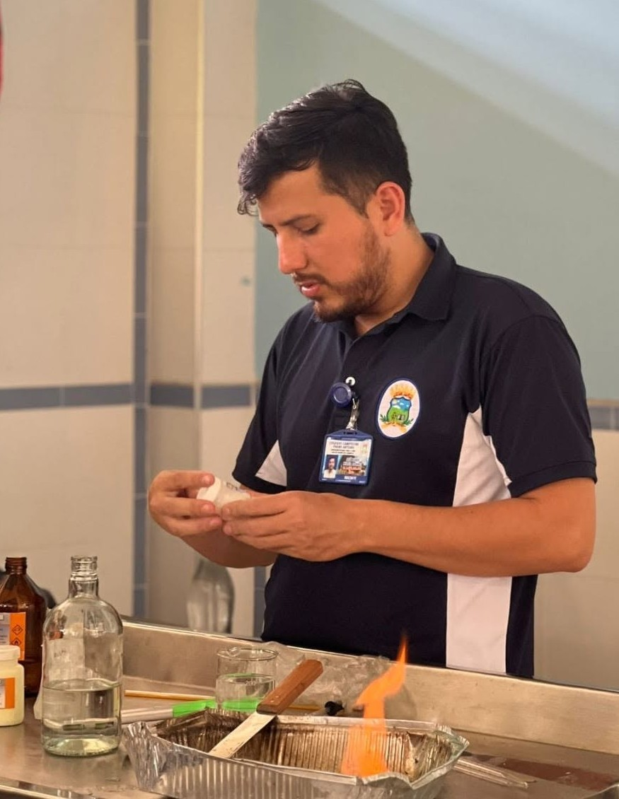

<style>
html, body {
  background: #dff3ec !important;
}

body {
  font-family: Arial, sans-serif;
}

.main-container {
  background: #ffffff !important;
  padding: 50px;
  padding-left: 65px;
  padding-right: 65px;
  margin: 40px auto;
  border-radius: 15px;
  max-width: 900px;
}

h1, h2, h3 {
  color: #246b5b;
}
</style>

<center>

</center>

# Hola, soy Manuel Murcia

## Estudiante de la UPR Mayagüez
### Maestría en Biología

##### Aquí se exponen los ejercicios de la Asignación 4 del curso RClass Fall 2026. Hora de Inicio: Jueves 29 de Octubre, 8:40 pm, finalización: Viernes 30 de octubre, 6:35 pm.

</center>

<p style="margin-top: 30px; margin-bottom: 20px;">
Desarrollo del ejercicio. <strong>Asignación 4:</strong>
</p>


```{r setup, include=TRUE, comment=NA, message=FALSE, warning=FALSE}
library(tidyverse)
library(lessR)
library(readxl)
library(BSDA)

mariposas <- read_excel("butterflies_pesticides.xlsx")

head(mariposas, 6)
```

### P1. Test de normalidad

```{r, comment=NA, echo=FALSE, message=FALSE, warning=FALSE}
# Grupo 1: Control
grupo1 <- mariposas$`Wing Length`[1:40]

# Grupo 2: Expuestos a pesticidas
grupo2 <- mariposas$`Wing Length`[41:80]

# test de normalidad
shapiro.test(grupo1)
shapiro.test(grupo2)
```
##### Debido a que ambos valores p son mayores que 0.05, no se rechaza la hipótesis nula de normalidad en ninguno de los grupos. Por lo tanto, los datos de ambos grupos son compatibles con una distribución normal.

### P2. Prueba de igualdad de varianzas

```{r, comment=NA, echo=FALSE, message=FALSE, warning=FALSE}
# Prueba de igualdad de varianzas entre los dos grupos
var.test(grupo1, grupo2)
```
##### Debido a que el valor p es menor que 0.05, se rechaza la hipótesis nula de igualdad de varianzas. Esto indica que existe una diferencia estadísticamente significativa en la variabilidad de la longitud de las alas entre el grupo control y el grupo expuesto a pesticidas.


### P3. Prueba estadística

```{r, comment=NA, echo=FALSE, message=FALSE, warning=FALSE}
# Prueba t independiente para comparar ambos grupos
t.test(
  grupo1,
  grupo2,
  alternative = "two.sided",
  mu = 0,
  paired = FALSE,
  var.equal = FALSE
)
```
##### Debido a que el valor p es menor que 0.05, se rechaza la hipótesis nula de igualdad de medias. El grupo control presentó una longitud promedio de alas de 632.18, mientras que el grupo expuesto a pesticidas presentó un promedio de 593.49. 

### P4. ggplot (20 puntos)

```{r, comment=NA, echo=FALSE, message=FALSE, warning=FALSE}
# Crear un conjunto de datos con las mediciones de ambos grupos
datos_grafica <- data.frame(
  longitud = c(grupo1, grupo2),
  grupo = factor(
    c(
      rep("Control", length(grupo1)),
      rep("Expuestos a pesticidas", length(grupo2))
    ),
    levels = c("Control", "Expuestos a pesticidas")
  )
)

# Crear gráfico de cajas para comparar ambos grupos
ggplot(datos_grafica, aes(x = grupo, y = longitud, fill = grupo)) +
  geom_boxplot() +
  labs(
    title = "Longitud de las alas de las mariposas en ambiente normal y expuesto a pesticidas",
    x = "Grupo experimental",
    y = "Longitud de las alas"
  ) +
  theme_minimal() +
  theme(legend.position = "none")
```


##### El grupo control presenta una mediana superior a la del grupo expuesto a pesticidas. Además, se observa una mayor dispersión de los datos en el grupo expuesto

### P5. Párrafo de resumen 

##### El objetivo de este análisis fue evaluar si existe una diferencia en la longitud de las alas de las mariposas entre un grupo control (40 individuos) y un grupo expuesto a pesticidas (40 individuos). 

##### Inicialmente, se realizó una prueba de normalidad de Shapiro-Wilk para determinar si las mediciones de cada grupo presentaban una distribución compatible con la normalidad. Los resultados fueron W = 0.95826 y p = 0.146 para el grupo control, y W = 0.97825 y p = 0.6247 para el grupo expuesto a pesticidas. Debido a que ambos valores p fueron mayores que 0.05, no se rechazó la hipótesis nula de normalidad. Después, se utilizó una prueba F para comparar las varianzas de los dos grupos, esta prueba produjo un valor F = 0.40274 y p = 0.005512, indicando una diferencia estadísticamente significativa entre las varianzas. Esto permitió determinar que no era apropiado asumir igualdad de varianzas para la comparación de las medias.

##### Considerando los resultados anteriores, se aplicó una prueba t de Welch para comparar las medias de longitud de las alas entre los dos grupos independientes. Se obtuvo un valor t = 3.9832, con 66.029 grados de libertad y un valor p = 0.0001721. Debido a que este valor p fue menor que 0.05, se rechazó la hipótesis nula de igualdad de medias. El grupo control presentó una longitud promedio de 632.18, mientras que el grupo expuesto a pesticidas presentó un promedio de 593.49, lo que representa una diferencia aproximada de 38.69 unidades. El intervalo de confianza del 95% para la diferencia entre las medias fue de 19.29 a 58.08 unidades, lo que respalda la existencia de una diferencia estadísticamente significativa entre ambos grupos.

##### La representación gráfica mediante un diagrama de cajas permitió visualizar estas diferencias, pues se observó una mediana mayor en el grupo control, mientras que el grupo expuesto a pesticidas presentó mayor dispersión. Este patrón visual coincide con los resultados de las pruebas estadísticas.

##### Desde el punto de vista biológico, los resultados sugieren una posible relación entre la exposición a pesticidas y la longitud de las alas de las mariposas. Una diferencia en esta característica podría tener importancia para aspectos relacionados con su desarrollo o desempeño biológico, aunque los datos analizados no permiten determinar si existen consecuencias sobre la supervivencia, la reproducción o la capacidad de vuelo. Además, es importante señalar una limitación del conjunto de datos: no se especifica la unidad de medida utilizada para registrar la longitud de las alas. Por esta razón, los resultados se expresan en unidades sin especificar. 


